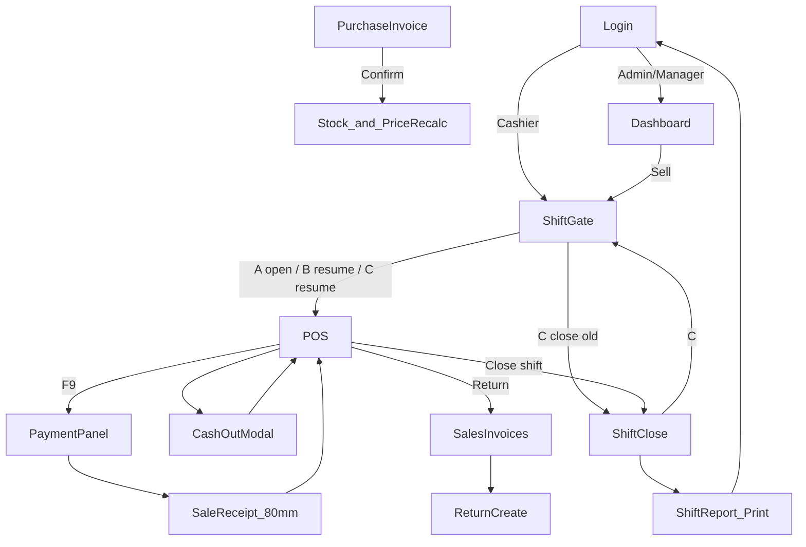

# تركيبة صفحات StoresPOS — مرجع التنفيذ

> **مرجع واجهة معتمد لكل صفحة.** المحتوى مستنتج من الرحلات A–H + القواعد المقفولة + الموديولات الـ 17 في الخطة.
> المصادر: [../plan.md](../plan.md) (المصدر الأساسي) · [client-proposal.html](client-proposal.html) / [client-proposal-ar.html](client-proposal-ar.html) · [mockup-shots/](mockup-shots/)
> لو حصل تعارض: `plan.md` يكسب. أي تغيير في قاعدة = تغيير نطاق، يتسجل في `plan.md` أولاً.
> آخر مراجعة: 2026-11-19 (بعد Phase 5).

---

## 0) إزاي تستخدم الملف ده

كل صفحة مكتوبة بنفس القالب عشان تتنفّذ مباشرة:

| البند | المعنى |
| --- | --- |
| **Route** | Controller/Action المقترح (فولدرات الـ Views موجودة فعلاً تحت `src/StoresPOS.PL/Views/`) |
| **Phase** | رقم المرحلة في `plan.md` |
| **Roles** | مين يدخل (حسب مصفوفة الصلاحيات) |
| **Flows** | الرحلات اللي بتعدّي على الصفحة |
| **المكوّنات** | المناطق والعناصر بالترتيب |
| **القواعد** | أرقام القواعد المقفولة في `plan.md` (R1…R10) |
| **الحالات** | الحالات الخمس (normal · empty · loading · error · confirm) + رسائل الصفحة |
| **الحالة الحالية** | ✅ منفّذ · 🟡 جزئي · ⬜ لم يبدأ |

**قواعد عامة لكل صفحة (Development Rules في الخطة):**

- كل التحقق الحساس **server-side**؛ الـ JS للراحة فقط.
- أي عملية مالية (بيع، مرتجع، مصروف، إغلاق وردية، تأكيد شراء) داخل **DB transaction**.
- فلوس = `decimal`، EGP، خانتين عشريتين، أرقام **tabular**، والفلوس أكبر وأوضح عنصر في الشاشة.
- كل شاشة لازم تشتغل RTL و LTR (استخدم logical properties: `margin-inline-start` …).
- Controllers ما تلمسش `DbContext` — كله عن طريق services في BLL.

---

## 1) الرحلات الثماني (المصدر)

| | الرحلة | الخطوات |
| --- | --- | --- |
| A | أول كاشير في اليوم | تسجيل الدخول → لا توجد وردية مفتوحة → فتح وردية (المبلغ اختياري) → البيع → إغلاق الوردية → العودة لتسجيل الدخول |
| B | انضمام كاشير ثانٍ | تسجيل الدخول → وردية مفتوحة بالفعل → استئناف → تسجيله كمشارك → نقطة البيع |
| C | وردية تُركت مفتوحة | تسجيل الدخول → ملخص الوردية القديمة → استئنافها أو إغلاقها → فتح وردية جديدة عند الإغلاق → نقطة البيع |
| D | بيع قطاعي | مسح / بحث → تعديل الكمية أو السعر → دفع · F9 → اختيار طريقة الدفع → حفظ + إيصال |
| E | مصروف نقدي | نقطة البيع أو صفحة الوردية → المبلغ + السبب → تحديث النقدية المتوقعة |
| F | شراء من مورد | فاتورة شراء جديدة → الأصناف + التكلفة → حفظ → زيادة المخزون → إعادة حساب الأسعار |
| G | مرتجع عميل | البحث عن الفاتورة → اختيار الأصناف والكمية → طريقة الاسترداد → تحديث المخزون والوردية |
| H | إغلاق الوردية | مراجعة الملخص → عدّ النقدية (اختياري) → تأكيد → طباعة التقرير → تسجيل الدخول |

---

## 2) خريطة الصفحات ↔ الرحلات ↔ المراحل

| # | الصفحة | Route | Flows | Phase | Roles | الحالة |
| --- | --- | --- | --- | --- | --- | --- |
| 3 | تسجيل الدخول | `Account/Login` | A B C H | 2 | الكل | ✅ (ناقص توجيه ما بعد الدخول → بوابة الوردية) |
| 4 | بوابة الوردية | `Shifts/Gate` | A B C | 6 | الكل | ⬜ |
| 5 | إغلاق الوردية | `Shifts/Close` | C H | 6 (+ طباعة 8) | Admin · Manager · Cashier (اختياري) | ⬜ |
| 6 | الورديات (الحالية + السجل + التفاصيل) | `Shifts/Current` · `Shifts/Index` · `Shifts/Details/{id}` | E H | 6 / 10 | الحالية: الكل · السجل: Admin · Manager | ⬜ |
| 7 | نقطة البيع POS | `POS/Index` | A B C D E G | 7 | الكل (بوردية مفتوحة) | ⬜ |
| 8 | لوحة الدفع | جزء من POS (modal) | D | 8 | الكل | ⬜ |
| 9 | الإيصال 80مم + تقرير الوردية | `Receipts/Sale/{id}` · `Receipts/Shift/{id}` | D H | 8 | الكل | ⬜ |
| 10 | المصروفات النقدية | modal في POS/Shift + `CashOuts/Index` | E | 9 | الكل | ⬜ |
| 11 | فواتير البيع | `Sales/Index` · `Sales/Details/{id}` | D G | 7 / 8 | Admin · Manager (+ Cashier: فواتير ورديته — مقترح) | ⬜ |
| 12 | المرتجعات | `Returns/Create?saleId=` · `Returns/Index` | G | 9 | Admin · Manager · Cashier (اختياري) | ⬜ |
| 13 | المنتجات | `Products/*` | D F G | 3 | Admin · Manager | ✅ |
| 14 | التصنيفات | `Categories/*` | D | 3 | Admin · Manager | ✅ |
| 15 | المخزون | `Inventory/Index · Movements · Adjust` | D F G | 5 | Admin · Manager | ✅ |
| 16 | فواتير الشراء | `Purchases/*` | F | 4 | Admin · Manager | ✅ |
| 17 | الموردون | `Suppliers/*` | F | 4 | Admin · Manager | ✅ |
| 18 | العملاء | `Customers/*` | D G | 10 | Admin · Manager (+ إضافة سريعة من POS) | ⬜ |
| 19 | الرئيسية Dashboard | `Home/Index` (أو `Dashboard/Index`) | — | 10 | Admin · Manager | 🟡 (هيكل فقط) |
| 20 | التقارير | `Reports/*` | — | 10 | Admin · Manager | ⬜ |
| 21 | المستخدمون والصلاحيات | `Users/*` | — | 11 (مقترح نقلها، شوف §24) | Admin | ⬜ |
| 22 | الإعدادات | `Settings/*` | — | 11 | Admin | ⬜ |

---

## 3) تسجيل الدخول — `Account/Login` · ✅

**Flows:** بداية A/B/C، ونهاية H. **القواعد:** R2 (الخروج لا يغلق الوردية)، R10.

**المكوّنات:**

- لوجو/اسم المتجر (من الإعدادات لاحقاً)
- تبديل لغة ع/EN (يحفظ في cookie ويقلب `dir`)
- اسم المستخدم + كلمة المرور + زر دخول (≥ 44px)

**بعد الدخول (⬜ مطلوب في Phase 6):**

| الدور | يروح فين |
| --- | --- |
| Cashier | `Shifts/Gate` دايماً — ما يوصلش لـ POS من غير المرور بالبوابة |
| Admin / Manager | `Home/Index` (Dashboard) بدون وردية؛ زر «بيع» في الـ Dashboard/السايدبار يفتح البوابة |

**بعد H:** يرجع هنا مع رسالة confirm «تم إغلاق الوردية #…».

**الحالات/الرسائل:** اسم مستخدم أو كلمة مرور خاطئة · الجلسة انتهت (token expired) · لا يمكن الوصول لقاعدة البيانات.

---

## 4) بوابة الوردية — `Shifts/Gate` · ⬜ Phase 6

**مش تاب سايدبار؛ خطوة إلزامية قبل POS.** Action واحد يقرأ حالة الوردية ويعرض واحدة من 3 حالات.
**القواعد:** R1 · R2 · R3 · R10.

### 4.1 لا توجد وردية مفتوحة (A)

- empty-state: «لا توجد وردية مفتوحة»
- حقل **مبلغ الافتتاح (اختياري)** — hint: «اتركه فارغاً للبدء من 0.00 ج.م» — فارغ = 0، سالب = خطأ
- زر أساسي **فتح وردية والبدء في البيع** → ينشئ `Shift` + أول `ShiftParticipant` → `POS/Index`

### 4.2 وردية مفتوحة اليوم (B)

- كارت ملخص: رقم الوردية · وقت الفتح · فتحها مين · المشاركون (chips) · شارة «وردية مفتوحة»
- زر **استئناف** → يسجّل المستخدم `ShiftParticipant` (لو مش مسجّل) → POS
- مفيش زر فتح وردية ثانية (R1)

### 4.3 وردية قديمة ما زالت مفتوحة (C)

«قديمة» = تاريخ فتحها قبل اليوم (للعرض والتنبيه فقط — الوردية **لا تُغلق تلقائياً** بسبب التاريخ، R2).

- شريط تنبيه warning: «الوردية #… مفتوحة منذ …»
- **ملخص الوردية القديمة** (نفس مكوّن §5 للقراءة فقط): أوقات · مشاركون · المتوقع في الدرج · عدد الفواتير
- إجراءان:
  - **استئنافها** → زي B
  - **إغلاقها** → `Shifts/Close?returnTo=Gate` → بعد التأكيد يرجع للبوابة في حالة 4.1 (فتح وردية جديدة) → POS
- لو المستخدم معندوش صلاحية الإغلاق: زر الإغلاق disabled مع رسالة «اطلب من المدير إغلاق الوردية» + زر الاستئناف متاح

**الحالات/الرسائل:** مبلغ افتتاح غير صالح · توجد وردية مفتوحة بالفعل (لو اتنين فتحوا في نفس اللحظة — يتعامل معها server-side ويحوّل لـ B) · الوردية أُغلقت بالفعل.

**ملاحظة تنفيذ:** منع فتح ورديتين متزامنتين لازم يكون في DB (unique filtered index على `Status = Open`) مش بس في الكود.

---

## 5) إغلاق الوردية — `Shifts/Close` · ⬜ Phase 6 (+ الطباعة في 8)

**Flows:** H، وجزء من C. **القواعد:** R4 · R5 · R7.

**المكوّنات (مطابقة لقسم 09 في الـ proposal):**

1. **هيدر:** «الوردية #142 · منى، أحمد» + شارة الحالة
2. **ملخص الدرج (نقدي فقط):**
   - مبلغ الافتتاح
   - مبيعات نقدية
   - مرتجعات نقدية (−)
   - مصروفات (عددها) (−)
   - **المتوقع في الدرج** = افتتاح + مبيعات نقدية − مرتجعات نقدية − مصروفات — بخط Display
3. **مبيعات غير نقدية · لا تدخل الدرج:** فيزا/كارت · إنستاباي · فودافون كاش (لون info)
4. **تفصيل حسب الكاشير** (جدول صغير: الكاشير · عدد الفواتير · نقدي · غير نقدي · مصروفات) — مطلوب في تقرير الوردية فيُعرض هنا كمان
5. حقل **النقدية الفعلية في الدرج (اختياري)**
   - فارغ → النتيجة **غير مُسوّاة / Not reconciled** (chip neutral) — مش «0 معدود»
   - مُدخل → **مطابق** (primary) / **زيادة +X** (warn) / **عجز −X** (danger) — يتحدث لحظياً
6. ملاحظات الإغلاق (اختياري — مقترح)
7. زر **تأكيد وإغلاق الوردية** → confirm dialog → حفظ → فتح `Receipts/Shift/{id}` للطباعة → logout → Login (أو للبوابة لو جاي من C)

**قاعدة البيع الجاري:** لو كاشير تاني عنده سلة فيها أصناف، الزر يتحول لحالة انتظار: «في انتظار إنهاء أو تعليق فاتورة {اسم الكاشير}» — الإغلاق يكمل بعد ما السلة تتحفظ أو تتعلق (شوف §24 للاقتراح التقني).

**الحالات/الرسائل:** مستخدم آخر يغلق الوردية الآن · الوردية أُغلقت بالفعل · لا صلاحية لإغلاق الوردية · بيع جارٍ.

---

## 6) الورديات — ⬜ Phase 6 (الحالية) / Phase 10 (السجل)

### 6.1 الوردية الحالية — `Shifts/Current`

صفحة الوردية المذكورة في E («نقطة البيع أو **صفحة الوردية**»):

- نفس ملخص الدرج من §5 (قراءة فقط، يتحدث بعد كل عملية)
- قائمة المشاركين + وقت الانضمام
- **سجل مصروفات الوردية** + زر **مصروف جديد** (يفتح §10)
- زر **إغلاق الوردية** (حسب الصلاحية) · زر **العودة للبيع**

### 6.2 سجل الورديات — `Shifts/Index` (Admin · Manager)

- فلاتر: من/إلى · الحالة (مفتوحة / مغلقة-مطابق / زيادة / عجز / غير مُسوّاة) · كاشير
- جدول: # · فتح · إغلاق · فتحها · أغلقها · المتوقع · الفعلي · الفرق · chip النتيجة
- empty-state لو مفيش نتائج

### 6.3 تفاصيل وردية — `Shifts/Details/{id}`

- كل محتوى §5 للقراءة + المبيعات حسب طريقة الدفع وحسب الكاشير + المصروفات + المرتجعات + روابط للفواتير
- زر **إعادة طباعة تقرير الوردية**

---

## 7) نقطة البيع POS — `POS/Index` · ⬜ Phase 7

**Flows:** «البيع» في A/B/C، مسرح D، مدخل E و G. **القواعد:** R5 · R6 · R9 · R10.
**Guard:** لو مفيش وردية مفتوحة أو المستخدم مش participant → redirect لـ `Shifts/Gate`.
**Layout:** بدون السايدبار العادي (شاشة كاملة 1366×768)، مع زر رجوع للإدارة لـ Admin/Manager.

### 7.1 الهيدر

اسم المتجر · شارة **وردية مفتوحة · #142** · الكاشير: {الاسم} · تبديل اللغة · **مصروف** (E) · **إغلاق الوردية** (يفتح §5، حسب الصلاحية) · المتوقع في الدرج (اختياري — مقترح يظهر للمدير فقط)

### 7.2 العمود الأول — البحث والمنتجات (خطوة «مسح / بحث» في D)

- حقل **باركود، اسم أو كود** + بادج `F2` — focus دائم بعد كل عملية؛ Enter على باركود مطابق = إضافة مباشرة
- pills التصنيفات: «الكل» + تصنيفات المستوى الأول (من شجرة §14)
- شبكة منتجات (كارت): الاسم بلغة الواجهة · السعر حسب الوضع (قطاعي/جملة) · المخزون · chip **مخزون منخفض** / **نفد**
- empty-state: «لا توجد منتجات تطابق "…"» + «امسح الباركود بدلاً من ذلك» + زر مسح البحث

### 7.3 العمود الثاني — الفاتورة (D)

1. سويتش **قطاعي / جملة** (segmented) — يغيّر أسعار السلة كلها (السطور اللي سعرها معدّل يدوياً تفضل زي ما هي)
2. **العميل · F4** — الافتراضي «عميل نقدي» + زر تغيير (بحث + إضافة سريعة بالاسم/الموبايل)
3. **فاتورة رقم S-000318** (رقم مبدئي يتأكد عند الحفظ)
4. سطور السلة: الاسم · كمية `−` `+` (و`Del` للحذف) · سعر الوحدة (قابل للتعديل **بصلاحية**) · chip **سعر معدّل** · إجمالي السطر
5. الإجماليات: **الإجمالي الفرعي** · **الخصم** · **الإجمالي** (Display 32/800)
6. أزرار ثانوية: **خصم · F6** (بصلاحية) · **تعليق · F8** · **الفواتير المعلّقة · F7** (بعدّاد) · **مرتجع** (يفتح `Sales/Index?mode=return`)
7. زر أساسي **دفع وطباعة · F9** (56px، disabled لو السلة فاضية)

### 7.4 اختصارات (لازم كلها تشتغل بدون ماوس)

| مفتاح | الوظيفة |
| --- | --- |
| F2 | focus البحث/الماسح |
| F4 | اختيار عميل |
| F6 | خصم |
| F7 | استئناف فاتورة معلّقة |
| F8 | تعليق الفاتورة |
| F9 | دفع وطباعة |
| + / − / Del | كمية السطر المحدد / حذفه |
| Esc | إغلاق أي modal |

### 7.5 قواعد السلة (server-side عند الحفظ)

- تعديل السعر يخص **السطر فقط**؛ يتخزن: سعر الكتالوج + السعر المُحصّل + المستخدم (R6)
- الخصم: قيمة أو % على الفاتورة، بصلاحية
- البيع فوق المخزون: **ممنوع افتراضياً** + override للمدير (قرار مفتوح — شوف §24)
- الفواتير المعلّقة مربوطة بالوردية؛ تعيش لحد إغلاق الوردية

**الحالات/الرسائل:** فاتورة فارغة · «متبقي 3 فقط من "سكر 1 كجم". قلّل الكمية إلى 3 أو أقل» · لا صلاحية لتغيير السعر · سعر غير صالح أو سالب · تعذّر حفظ الفاتورة.

---

## 8) لوحة الدفع — modal داخل POS · ⬜ Phase 8

**Flows:** D (ونهاية البيع في A). **القواعد:** R5.

- الإجمالي المطلوب (Display)
- طرق الدفع (أزرار كبيرة): **نقدي** · **فيزا/كارت** · **إنستاباي** · **فودافون كاش** — طريقة واحدة لكل فاتورة في v1 (no split tender)
- نقدي: حقل **المدفوع** (default = الإجمالي) + أزرار مبالغ سريعة (مقترح: 50/100/200/500) + **الباقي** لحظياً
- غير نقدي: حقل مرجع العملية (اختياري — مقترح)
- زر **تأكيد** (Enter) → transaction واحدة: حفظ الفاتورة على **الوردية + الكاشير** · خصم المخزون (`StockMovementType.Sale`) · تسجيل الدفع
- بعد النجاح: toast «تم الدفع. الباقي: 44.00 ج.م. تم إرسال الإيصال للطابعة» → طباعة §9 → سلة فاضية وfocus على البحث

**الحالات/الرسائل:** «المدفوع 300.00 أقل من الإجمالي 356.00» · مخزون غير كافٍ (لو اتغيّر أثناء البيع) · تعذّر الحفظ · بدأت الطباعة.

---

## 9) الإيصالات — ⬜ Phase 8

### 9.1 إيصال البيع 80مم — `Receipts/Sale/{id}`

view منفصل بـ print CSS (عرض 80mm، بدون layout)، بلغة المتجر الافتراضية:

1. اسم المتجر · العنوان · الهاتف · الرقم الضريبي · لوجو (من الإعدادات)
2. «فاتورة بيع (قطاعي/جملة)» · رقم الفاتورة · التاريخ والوقت · الكاشير · العميل
3. جدول: الصنف · كمية · سعر **المُحصّل فعلاً** · إجمالي
4. عدد القطع · الإجمالي قبل الخصم · الخصم · الضريبة (حسب الإعداد) · **الإجمالي**
5. طريقة الدفع · المدفوع · الباقي
6. رسالة الفوتر · **باركود رقم الفاتورة** (يُستخدم للمرتجع السريع في G)

### 9.2 تقرير الوردية — `Receipts/Shift/{id}`

نفس الفورمات: أوقات الفتح/الإغلاق · فتحها/أغلقها · المشاركون · المبيعات حسب الطريقة وحسب الكاشير · المصروفات · المتوقع · الفعلي · نتيجة التسوية.

---

## 10) المصروفات النقدية — ⬜ Phase 9

**Flows:** E. **القواعد:** R7.

### 10.1 Modal مصروف سريع (من POS هيدر و `Shifts/Current`)

- **المبلغ** (> 0) — رسالة: مبلغ غير صالح
- **السبب** (مطلوب) — hint: «مثال: أدوات نظافة» — رسالة: السبب مطلوب
- ربط تلقائي بالوردية المفتوحة + المستخدم الحالي (مش حقول ظاهرة)
- بعد الحفظ: toast + تحديث «المتوقع في الدرج» فوراً
- لو المبلغ > المتوقع في الدرج: تحذير (مقترح) مش منع

### 10.2 سجل المصروفات — `CashOuts/Index`

- فلاتر: من/إلى · وردية · مستخدم
- جدول: التاريخ · الوردية · المستخدم · المبلغ · السبب + إجمالي الفلتر
- Cashier يشوف مصروفات الوردية الحالية بس (مقترح)

---

## 11) فواتير البيع — `Sales/*` · ⬜ Phase 7 (القائمة) / 8 (إعادة الطباعة)

**Flows:** بداية G («البحث عن الفاتورة») + أثر D. **القواعد:** R9.

### 11.1 القائمة — `Sales/Index`

- بحث: رقم الفاتورة / **مسح باركود الإيصال** / تاريخ من-إلى / عميل / كاشير / طريقة دفع / وردية
- جدول: الرقم · التاريخ · الكاشير · العميل · قطاعي/جملة · الطريقة (chip) · الإجمالي · chip «مرتجع جزئي/كلي»
- `?mode=return` (لما ييجي من زر مرتجع في POS): البحث بالباركود focus مباشرة، والنتيجة الوحيدة تفتح `Returns/Create` على طول

### 11.2 التفاصيل — `Sales/Details/{id}`

- هيدر الفاتورة + السطور **بالأسعار وقت البيع** (مش أسعار اليوم) + علامة السطور المعدّلة (السعر الأصلي، السعر المحصّل، مين عدّله)
- الدفع · المرتجعات المرتبطة
- إجراءات: **إعادة طباعة الإيصال** · **بدء مرتجع**

---

## 12) المرتجعات — `Returns/*` · ⬜ Phase 9

**Flows:** باقي G. **القواعد:** R5 · R9.

### 12.1 إنشاء مرتجع — `Returns/Create?saleId=`

- ملخص الفاتورة الأصلية (رقم، تاريخ، عميل، طريقة الدفع)
- جدول: الصنف · المُباع · المُرتجع سابقاً · **المتاح للإرجاع** · حقل كمية الإرجاع (≤ المتاح) · السعر الأصلي · الإجمالي
- **طريقة الاسترداد:** نقدي (يُخصم من درج **الوردية الحالية**) / نفس طريقة الدفع الأصلية غير النقدية (تُسجّل ولا تلمس الدرج)
- سبب المرتجع (مقترح: مطلوب)
- موافقة مدير لو الكاشير معندوش الصلاحية (قرار مفتوح: موافقة مدير + خلال 14 يوم)
- تأكيد → transaction: مستند مرتجع · `StockMovementType.SaleReturn` · تحديث الوردية لو نقدي · طباعة إيصال مرتجع (مقترح)

**يتطلب وردية مفتوحة** لو الاسترداد نقدي (عشان الفلوس طالعة من الدرج).

### 12.2 قائمة المرتجعات — `Returns/Index`

فلاتر (تاريخ، كاشير، فاتورة أصلية، طريقة) + جدول: رقم المرتجع · الفاتورة الأصلية · التاريخ · المستخدم · المبلغ · الطريقة.

**الحالات/الرسائل:** الكمية أكبر من المتاح · الفاتورة خارج مدة الإرجاع · لا صلاحية · لا توجد وردية مفتوحة (للاسترداد النقدي).

---

## 13) المنتجات — `Products/*` · ✅ Phase 3

**يدعم:** D (البحث والسعر)، F (التكلفة)، G (الإرجاع). **القواعد:** R8 · R9.

- **Index:** بحث (اسم/باركود) · فلتر تصنيف · فلتر حالة المخزون · جدول: الاسم · الباركود · التصنيف · الوحدة · قطاعي · جملة · المخزون · chip منخفض/نفد · تابات `_CatalogTabs` (منتجات/تصنيفات/مخزون)
- **Create/Edit (`_ProductForm`):** اسم ع/EN · باركود · وحدة · تصنيف (من الشجرة) · **بلوك التسعير** (سعر شراء ↔ نسبة/سعر قطاعي ↔ نسبة/سعر جملة، مستقلان — `product-pricing.js`) · حد التنبيه
- **Details:** البيانات + آخر حركات المخزون للمنتج + آخر فواتير شراء
- **تعطيل** بدل الحذف (المنتج مستخدم في فواتير قديمة)

**المتبقي:** لا شيء للـ v1. (المخزون الافتتاحي يدخل عن طريق Adjust أو أول فاتورة شراء.)

---

## 14) التصنيفات — `Categories/*` · ✅ Phase 3

- شجرة بعمق غير محدود · **سحب لإعادة الترتيب أو النقل** (Move/Reorder) · تعطيل
- تغذّي: pills الـ POS (§7.2) واختيار التصنيف في §13

---

## 15) المخزون — `Inventory/*` · ✅ Phase 5

**يثبت أن خطوة «تحديث المخزون» حصلت في D و F و G.**

- **Index (الأرصدة):** بحث · فلتر «منخفض فقط» + عدّاد · جدول: المنتج · الرصيد · الحد · chip
- **Movements:** فلتر منتج/نوع/تاريخ · جدول: التاريخ · النوع (شراء / بيع / مرتجع بيع / تسوية) · الكمية ± · الرصيد بعد · المستخدم · المرجع (رابط للفاتورة)
- **Adjust:** delta (+/−) أو كمية معدودة · **سبب مطلوب** · المستخدم يتسجل · ممنوع تحت الصفر

**المتبقي:** لما تتنفّذ المبيعات/المرتجعات، عمود المرجع لازم يربط `Sales/Details` و`Returns`.

---

## 16) فواتير الشراء — `Purchases/*` · ✅ Phase 4

**Flows:** F كاملة. **القواعد:** R8 · R9.

- **Index:** فلتر مورد/حالة/تاريخ · جدول: الرقم · المورد · التاريخ · الحالة (مسودة/مؤكدة) · الإجمالي
- **Create/Edit (`_PurchaseForm`, مسودة فقط):** المورد · رقم فاتورة المورد · التاريخ · ملاحظات · سطور (منتج · كمية · تكلفة الوحدة · إجمالي) · الإجمالي
- **Confirm** (لا رجوع): زيادة المخزون (`Purchase` movement) + تحديث سعر الشراء + إعادة حساب قطاعي/جملة من النسب المحفوظة
- **Details:** لقطة الأسماء والتكاليف وقت الشراء + مين أنشأ ومين أكّد

**مقترح لاحق:** عرض «السعر القديم → الجديد» لكل منتج في شاشة التأكيد قبل الضغط (عشان المدير يشوف أثر الـ recalc).

---

## 17) الموردون — `Suppliers/*` · ✅ Phase 4

- **Index:** بحث + عرض المعطّلين
- **Form:** اسم ع/EN · هاتف · إيميل · عنوان · ملاحظات
- **Details:** بيانات الاتصال · **سجل المشتريات + الإجماليات** · زر **فاتورة شراء جديدة لهذا المورد** (`Purchases/Create?supplierId=`)

---

## 18) العملاء — `Customers/*` · ⬜ Phase 10

- عميل افتراضي ثابت «عميل نقدي / Walk-in» (seed، لا يُحذف ولا يُعدّل)
- **Index/Form:** الاسم · الموبايل · العنوان · ملاحظات · نوع افتراضي (قطاعي/جملة — مقترح، يحدد وضع POS تلقائياً)
- **Details:** سجل المشتريات + المرتجعات + الإجمالي
- **إضافة سريعة من POS (F4):** الاسم + الموبايل فقط

---

## 19) الرئيسية Dashboard — `Home/Index` · 🟡 Phase 10

للـ Admin/Manager (الكاشير ما يشوفهاش — يروح البوابة).

- كروت KPI: مبيعات اليوم · نقدي مقابل غير نقدي · عدد الفواتير · المرتجعات
- **حالة الوردية:** مفتوحة/لا (+ المتوقع في الدرج + المشاركون) + زر **بيع** (→ البوابة)
- **تنبيهات المخزون:** عدد المنخفض + أول 5 + رابط `Inventory?lowOnly=true`
- **آخر النشاط:** آخر فواتير / مصروفات / مشتريات مؤكدة

---

## 20) التقارير — `Reports/*` · ⬜ Phase 10

كل تقرير: فلاتر (تاريخ من-إلى + فلاتر خاصة) · جدول · إجماليات · زر **طباعة**.

| التقرير | الفلاتر | المحتوى |
| --- | --- | --- |
| المبيعات | كاشير · طريقة · قطاعي/جملة · تصنيف | الإجمالي، حسب الطريقة، حسب الكاشير، الأكثر مبيعاً، الربح (متوسط مرجح للتكلفة — قرار مفتوح) |
| المشتريات | مورد | إجمالي حسب المورد والمنتج |
| المخزون | تصنيف · منخفض | الأرصدة · قيمة المخزون بالتكلفة · الحركات |
| الورديات | كاشير · النتيجة | الفروقات · غير المُسوّاة · المبيعات حسب الكاشير |
| المصروفات | مستخدم | الإجمالي حسب السبب/المستخدم |

---

## 21) المستخدمون والصلاحيات — `Users/*` · ⬜ (Admin فقط)

- **Users:** قائمة · إنشاء (اسم مستخدم، اسم عرض، دور، كلمة مرور) · تفعيل/تعطيل · إعادة تعيين كلمة المرور
- **Roles:** مصفوفة صلاحيات قابلة للتبديل لكل دور (switches) — البنود: استخدام POS · فتح/استئناف وردية · إغلاق وردية · تعديل السعر · خصم · مصروفات · مرتجعات · منتجات وتصنيفات · مشتريات وموردون · تسوية مخزون · تقارير · مستخدمون · إعدادات/نسخ/ترخيص

---

## 22) الإعدادات — `Settings/*` · ⬜ Phase 11 (Admin فقط)

تابات (الاسم في الواجهة **«الإعدادات / Settings»** — مش «Configuration»):

| تاب | المحتوى |
| --- | --- |
| ملف المتجر | الاسم ع/EN · العنوان · الهاتف · الرقم الضريبي · اللوجو |
| المبيعات والضريبة | الأسعار شاملة الضريبة؟ · النسبة (مقترح 14%) · البيع تحت الصفر · مدة المرتجع |
| الترقيم | بادئة/بداية أرقام فواتير البيع والمرتجعات |
| الطباعة | عرض الورق · هيدر/فوتر · لغة الإيصال · أرقام عربية/غربية للإيصال |
| اللغة | لغة الواجهة الافتراضية |
| قاعدة البيانات والنسخ | نسخ احتياطي الآن · جدولة يومية + عند إغلاق الوردية · المسار · استعادة |
| الترخيص | حالة التفعيل · رفع ملف الترخيص |

---

## 23) مكوّنات مشتركة (Shared) — تُبنى مرة وتتعاد

| المكوّن | موجود؟ | يُستخدم في |
| --- | --- | --- |
| `_Layout` (سايدبار داكن + main) | ✅ | كل صفحات الإدارة |
| `_LoginLayout` | ✅ | Login |
| `_PageHeader` (عنوان + subtitle + أزرار) | ✅ | كل الصفحات |
| `_EmptyState` | ✅ | كل القوائم |
| `_CatalogTabs` | ✅ | منتجات/تصنيفات/مخزون |
| `_PosLayout` (بدون سايدبار، full screen) | ⬜ | POS، البوابة |
| `_PrintLayout` (80mm) | ⬜ | الإيصال، تقرير الوردية |
| `_ShiftSummary` (ملخص الدرج + غير النقدي) | ⬜ | البوابة C · الإغلاق · الوردية الحالية · التفاصيل · Dashboard |
| `_StatusChip` (Shift open · Matched · Surplus · Shortage · Not reconciled · Closed · Low stock · Out of stock · Held · طرق الدفع) | ⬜ | كل مكان |
| `_MoneyText` / tag helper للفلوس (EGP، خانتين، tabular) | ⬜ | كل مكان |
| `_ConfirmDialog` | ⬜ | الإغلاق، تأكيد الشراء، التعطيل، المرتجع |
| `_Toast` (رسائل confirm/error) | ⬜ | كل الـ POST |
| `_CashOutModal` | ⬜ | POS · الوردية الحالية |
| `_DateRangeFilter` | ⬜ | كل القوائم والتقارير |

**الحالات الخمس لكل شاشة:** normal · empty (`_EmptyState`) · loading (skeleton/disabled button) · error (رسالة تقول إيه حصل وإيه الخطوة الجاية) · confirm (toast/dialog).

---

## 24) اقتراحات وفجوات لازم تتحسم قبل/أثناء Phase 6–7

### أ) فجوات في الكود الحالي

1. **الصلاحيات «الاختيارية» للكاشير مش ممكنة حالياً.** كل الـ controllers بتستخدم `[Authorize(Roles=…)]`. تعديل السعر/الخصم/المرتجع/إغلاق الوردية محتاجين **permission-based policies** (جدول `RolePermissions` + claims في الـ JWT + `[Authorize(Policy="Shifts.Close")]`). **اقتراح:** نقل جزء «الصلاحيات» من صفحة Users (§21) لبداية Phase 6 لأن الإغلاق أول حاجة هتحتاجه. صفحة إدارة المستخدمين نفسها ممكن تفضل لاحقاً.
2. **التوجيه بعد الدخول:** حالياً الكل يروح `Home/Index`. لازم الكاشير يروح `Shifts/Gate` (Phase 6).
3. ✅ *(اتطبّق 2026-11-19 — الروابط لسه disabled لحد مراحلها)* **السايدبار:** كان ناقصه **الورديات** و**المصروفات**؛ و«Configuration» لازم تبقى «Settings» زي الـ proposal؛ و«POS» لازم يفتح البوابة. ترتيب مقترح: الرئيسية · نقطة البيع · الورديات · فواتير البيع · المرتجعات · المصروفات · المنتجات والتصنيفات · المشتريات · الموردون · العملاء · التقارير · المستخدمون · الإعدادات.
4. **الترجمة:** نصوص السايدبار والصفحات English hard-coded وفولدر `Resources/` فاضي. **اقتراح:** ندخل `IStringLocalizer` + resx الآن قبل ما صفحات POS تتبني، بدل ما نرجع نترجم 15 صفحة بعدين.
5. **منع ورديتين مفتوحتين:** لازم unique filtered index في DB + transaction، مش check في الكود بس.

### ب) قواعد محتاجة قرار تقني

6. **«انتظار بيع جارٍ قبل الإغلاق»** (R في §5): السلة حالياً هتكون client-side، فالسيرفر مش هيعرف إن فيه بيع جارٍ. **اقتراح:** السلة تتحفظ كـ `SalesInvoice` بحالة `Draft` مربوطة بالكاشير (تتحدث مع كل إضافة)، والإغلاق يرفض لو فيه Draft غير فاضي → ده كمان بيحل «التعليق F8» (Draft → Held) وبيحمي السلة لو المتصفح اتقفل.
7. **«وردية قديمة» (C):** نعرّفها = فُتحت قبل اليوم الحالي (توقيت المتجر المحلي، مش UTC) — للتنبيه فقط.
8. **الفواتير المعلّقة عند الإغلاق:** القرار المقترح «تعيش لحد الإغلاق ثم تُعرض للإلغاء أو الاستئناف» — محتاج شاشة صغيرة في الإغلاق: «يوجد 2 فاتورة معلّقة: إلغاء الكل / نقلها للوردية الجديدة».
9. **المرتجع النقدي على وردية مختلفة:** المرتجع النقدي يُخصم من **الوردية المفتوحة الحالية** مش وردية البيع الأصلية — يتكتب في الخطة صراحة.

### ج) فروقات بين الـ proposal والخطة (لازم تتوحد)

10. **ترقيم المراحل:** الـ proposal P0–P10 و«2/11 phases delivered» و Phase «Next» = P2؛ الخطة 1–11 وخلّصنا 5. **اقتراح:** تحديث قسم 12 في الـ proposal (EN + AR) قبل ما يتبعت للعميل تاني.
11. **Dark mode:** الـ proposal بيقول «dark mode for evening shifts» والخطة ما ذكرتهوش. إما نضيفه للخطة (التوكنز في `theme.css` تسهّل ده) أو نشيله من الـ proposal.
12. **القرارات المفتوحة** (درج واحد، لا split، 14 يوم مرتجع، منع البيع تحت الصفر، 14% ضريبة، متوسط مرجح، نسخ يومي، ترخيص، أرقام غربية): لسه «proposals». **محتاجين تأكيد العميل قبل Phase 7** لأن 4 منهم بيأثروا على POS مباشرة (split, zero stock, tax, held).

### د) تحسينات UX مقترحة (مش في النطاق — تتأكد قبل التنفيذ)

13. أزرار مبالغ نقدية سريعة في لوحة الدفع (§8).
14. «آخر فاتورة» في هيدر POS لإعادة الطباعة السريعة.
15. معاينة «السعر القديم → الجديد» قبل تأكيد فاتورة الشراء (§16).
16. نوع العميل الافتراضي (قطاعي/جملة) يقلب وضع POS تلقائياً (§18).
17. إيصال مرتجع مطبوع (§12).

---

## 25) ترتيب التنفيذ المقترح لـ Joo (Phase 6 → 7)

1. Permissions (جدول + policies) — §24.1
2. `Shift` · `ShiftParticipant` entities + migration + unique open index
3. `IShiftService`: GetGateState · Open · Resume · GetSummary · Close (+ tests لكل حالة A/B/C/H + Not reconciled)
4. `_ShiftSummary` + `_StatusChip` + `_MoneyText`
5. `Shifts/Gate` + توجيه ما بعد الدخول
6. `Shifts/Close` + `Shifts/Current`
7. `_PosLayout` + `POS/Index` (Draft invoice server-side — §24.6)
8. تحديث `STATUS.md` بعد كل خطوة متحقق منها
