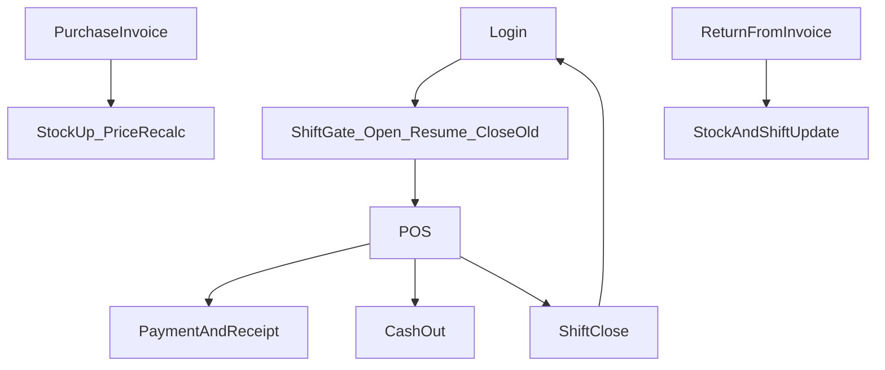

# تركيبة صفحات StoresPOS (مستنتجة من الـ Flows)

> **مرجع واجهة معتمد.** محتوى كل صفحة هنا مبني على خطوات الرحلات A–H في الـ proposal، مش قائمة عامة.  
> المصادر: [client-proposal-ar.html](client-proposal-ar.html) §04 · [../plan.md](../plan.md)

---

## الرحلات الثماني (المصدر)

| | الرحلة | الخطوات |
| --- | --- | --- |
| A | أول كاشير في اليوم | تسجيل الدخول → لا توجد وردية مفتوحة → فتح وردية (المبلغ اختياري) → البيع → إغلاق الوردية → العودة لتسجيل الدخول |
| B | انضمام كاشير ثانٍ | تسجيل الدخول → وردية مفتوحة بالفعل → استئناف → تسجيله كمشارك → نقطة البيع |
| C | وردية تُركت مفتوحة | تسجيل الدخول → ملخص الوردية القديمة → استئنافها أو إغلاقها → فتح وردية جديدة عند الإغلاق → نقطة البيع |
| D | بيع قطاعي | مسح / بحث → تعديل الكمية أو السعر → دفع · F9 → اختيار طريقة الدفع → حفظ + إيصال |
| E | مصروف نقدي | نقطة البيع أو صفحة الوردية → المبلغ + السبب → تحديث النقدية المتوقعة |
| F | شراء من مورد | فاتورة شراء جديدة → الأصناف + التكلفة → حفظ → زيادة المخزون → إعادة حساب الأسعار |
| G | مرتجع عميل | البحث عن الفاتورة → اختيار الأصناف والكمية → طريقة الاسترداد → تحديث المخزون والوردية |
| H | إغلاق الوردية | مراجعة الملخص → عدّ النقدية (اختياري) → تأكيد → طباعة التقرير → تسجيل الدخول |

---

## أي Flow يمر على أي صفحة

| الصفحة | Flows |
| --- | --- |
| تسجيل الدخول | A, B, C, H |
| بوابة / شاشات الوردية | A, B, C, E, H |
| نقطة البيع POS | A, B, C, D, E, G (دخول للمرتجع) |
| دفع + إيصال | D |
| مصروف نقدي | E |
| فاتورة شراء | F |
| منتجات (أسعار/مخزون تتأثر) | F, D, G |
| فواتير البيع (بحث أصل المرتجع) | G |
| مرتجعات | G |
| موردون | F (اختيار المورد) |

---

## 1) تسجيل الدخول — محتوى مطلوب من A/B/C/H

**لماذا:** كل رحلة كاشير تبدأ أو تنتهي هنا.

- تبديل لغة (عربي/إنجليزي)
- اسم مستخدم + كلمة مرور
- بعد نجاح الدخول **للكاشير:** لا يذهب مباشرة للبيع — يدخل **بوابة الوردية** (شوف §2)
- بعد نجاح الدخول **للإدارة:** يمكن Dashboard بدون وردية
- بعد إغلاق وردية (H): يرجع لنفس الشاشة (حالة محفوظة: الوردية مغلقة)

---

## 2) بوابة الوردية (بعد Login / قبل POS) — من A/B/C/H

مش تاب سايدبار؛ خطوة إلزامية للكاشير. محتواها حسب الحالة:

### لو لا توجد وردية مفتوحة (A)

- رسالة: لا توجد وردية مفتوحة
- نموذج **فتح وردية**: مبلغ الافتتاح **اختياري** (فارغ = 0)
- تأكيد → الدخول للبيع (POS)

### لو توجد وردية مفتوحة (B)

- ملخص مختصر للوردية الحالية
- زر **استئناف** → تسجيل المستخدم كمشارك → POS
- (لا يُفتح وردية ثانية)

### لو وردية قديمة ما زالت مفتوحة (C)

- **ملخص الوردية القديمة** (أوقات، مشاركون، نقدية متوقعة…)
- إجراءان: **استئنافها** أو **إغلاقها**
- لو اختار الإغلاق: يكمل شاشة الإغلاق (مثل H) ثم **فتح وردية جديدة** ثم POS

### من داخل POS / إغلاق (H + جزء من A)

شاشة **إغلاق الوردية** محتواها:

- مراجعة الملخص: افتتاح · مبيعات نقدية · مرتجعات نقدية · مصروفات · **المتوقع في الدرج**
- مبيعات غير نقدية (فيزا / إنستاباي / محفظة) — ظاهرة و**لا تدخل الدرج**
- حقل **النقدية الفعلية اختياري** (فارغ = غير مُسوّاة، مش صفر)
- نتيجة: مطابق / زيادة / عجز عند إدخال مبلغ
- تأكيد → طباعة تقرير الوردية → العودة لتسجيل الدخول
- لو كاشير آخر في منتصف بيع: انتظار اكتمال/تعليق الفاتورة قبل الإغلاق

---

## 3) نقطة البيع POS — من A/B/C/D/E/G

**لماذا:** نقطة «البيع» في A/B/C ومسرح الرحلة D، ومدخل لـ E وG.

**هيدر (من قواعد الوردية):**

- اسم المتجر · شارة وردية مفتوحة · اسم الكاشير · لغة · **Close shift** (يفتح §2 إغلاق)

**يسار — عشان خطوة «مسح / بحث» في D:**

- بحث باركود/اسم (F2)
- pills تصنيفات
- شبكة منتجات: اسم · سعر (حسب قطاعي/جملة) · مخزون · Low stock

**يمين — عشان الكمية/السعر والدفع في D:**

- Retail / Wholesale
- عميل F4 (افتراضي: عميل نقدي) — يجهّز G لاحقاً بربط فاتورة
- بنود السلة: كمية +/− · تعديل سعر السطر (وسم edited) · إجمالي سطر
- Subtotal · Discount · Total بارز
- **Discount · Hold F8 · Return** (Return يفتح مسار G)
- مدخل مصروف سريع إن لزم (E) أو من شاشة الوردية
- **Pay and print · F9** → شاشة/لوحة الدفع

---

## 4) الدفع + الإيصال — من D (ونهاية البيع في A)

**لماذا:** خطوات «دفع · F9 → اختيار طريقة الدفع → حفظ + إيصال».

- اختيار طريقة: نقدي (مع الباقي) · فيزا · إنستاباي · فودافون كاش
- تأكيد يحفظ الفاتورة على **الوردية + الكاشير** ويخصم المخزون
- طباعة إيصال 80مم (أسعار محصّلة، خصم، مدفوع، باقي، باركود فاتورة)
- العودة لسلة فاضية جاهزة لبيع جديد (نفس الوردية)

---

## 5) المصروف النقدي — من E

**لماذا:** «المبلغ + السبب → تحديث النقدية المتوقعة».

يظهر من POS أو من صفحة/ملخص الوردية:

- حقل مبلغ (> 0)
- حقل سبب (مطلوب)
- ربط تلقائي: الوردية المفتوحة + المستخدم الحالي
- بعد الحفظ: خصم من المتوقع في الدرج (يظهر لاحقاً في ملخص H)
- سجل مصروفات الوردية (اختياري في نفس الشاشة أو قائمة)

---

## 6) فواتير الشراء — من F

**لماذا:** الرحلة كاملة F.

محتوى الشاشة:

- اختيار **مورد** (يحتاج شاشة/قائمة موردين)
- تاريخ + رقم فاتورة
- بنود: منتج · كمية · تكلفة الوحدة
- حفظ/تأكيد → **زيادة المخزون** + **تحديث سعر الشراء** + **إعادة حساب قطاعي/جملة من نسب الربح المحفوظة**
- عرض بعد التأكيد: لقطة الأسماء والتكاليف (ما تتغيرش لو اتعدّل المنتج بعدين)

---

## 7) المنتجات والتصنيفات (دعم D و F و G)

مش رحلة لوحدها، لكن الـ Flows تفترض وجودها:

**قائمة/بطاقة منتج يجب أن تحمل عشان D و F:**

- أسماء ع/EN · باركود · وحدة · تصنيف
- سعر شراء · نسبة/سعر قطاعي · نسبة/سعر جملة (مستقلان)
- مخزون حالي · حد تنبيه (Low stock على POS)

**التصنيفات:** شجرة للفلترة على POS (pills) ولاختيار التصنيف عند إضافة منتج

**المخزون/الحركات:** نتيجة F (زيادة) و D/G (نقص/إرجاع) — شاشة أرصدة + حركات تثبت أن الخطوة «تحديث المخزون» حصلت

---

## 8) فواتير البيع — من G (ومن أثر D)

**لماذا:** G يبدأ بـ «البحث عن الفاتورة».

- بحث برقم فاتورة / باركود إيصال / تاريخ / عميل
- تفاصيل فاتورة محفوظة **بالأسعار وقت البيع** (مش أسعار اليوم)
- إجراءات: إعادة طباعة إيصال · **بدء مرتجع**

---

## 9) المرتجعات — من G

**لماذا:** باقي خطوات G.

- عرض أصناف الفاتورة الأصلية مع الكميات القابلة للإرجاع
- اختيار أصناف وكميات (≤ المباعة)
- طريقة الاسترداد (نقدي يلمس الوردية؛ غير نقدي حسب السجل)
- تأكيد → **تحديث المخزون** + **تحديث الوردية** إن لزم
- قائمة مرتجعات سابقة للتحقق

---

## 10) الموردون — من F

**لماذا:** فاتورة الشراء تحتاج مورداً.

- قائمة/نموذج اتصال
- من بطاقة المورد: الدخول لفاتورة شراء جديدة أو سجل مشترياته (أثر F)

---

## صفحات خارج الـ Flows اليومية (لكن في التقسيمة)

هذه **مش مستنتجة من A–H**؛ من الموكب/الـ proposal للإدارة. تُبنى لاحقاً دون خلطها بمحتوى الرحلات:

| الصفحة | محتواها باختصار |
| --- | --- |
| Dashboard | ملخص يومي بعد ما رحلات البيع/الوردية تشتغل |
| Customers | إدارة عملاء أبعد من «عميل نقدي» الافتراضي في D |
| Reports | تجميع نتائج A–H (مبيعات، ورديات، مصروفات، مخزون) |
| Users and roles | من يشغّل أي خطوة في الـ Flows |
| Configuration | ضريبة على الإيصال، ترقيم الفواتير، طباعة، نسخ، ترخيص |

---

## حالات واجهة تفرضها الـ Flows

| الحالة | من أين |
| --- | --- |
| لا توجد وردية مفتوحة | A |
| توجد وردية مفتوحة بالفعل | B |
| ملخص وردية قديمة + استئناف/إغلاق | C |
| فاتورة فارغة / مبلغ نقدي أقل من المطلوب | D |
| سبب المصروف مفقود / مبلغ غير صالح | E |
| مخزون غير كافٍ عند البيع | D (+ سياسة المخزون) |
| مستخدم آخر يغلق الوردية / بيع جارٍ | H |
| تم الدفع / بدأت الطباعة | D |

(تفاصيل الرسائل في proposal §10.)

---

## حالة التنفيذ vs الـ Flows

| Flow | جاهزية تقريبية |
| --- | --- |
| F شراء | جزئي (موردون + مشتريات + مخزون/أسعار) |
| D/E/G/A/B/C/H | تحتاج POS + ورديات + دفع + مرتجعات |
